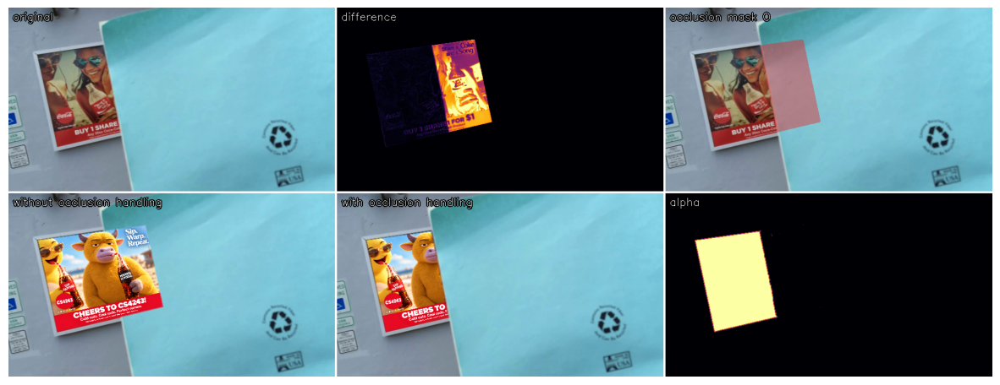
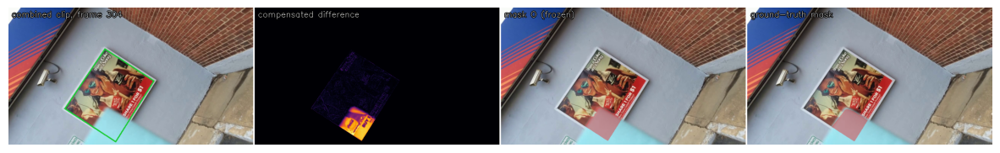
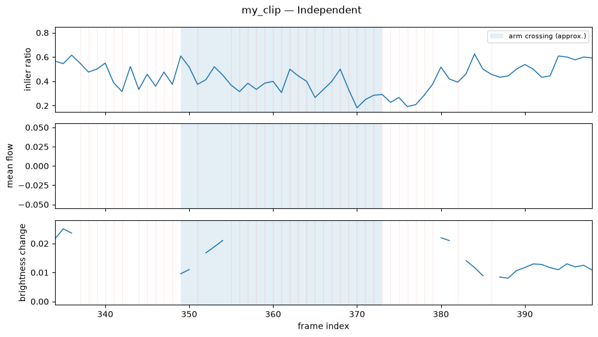
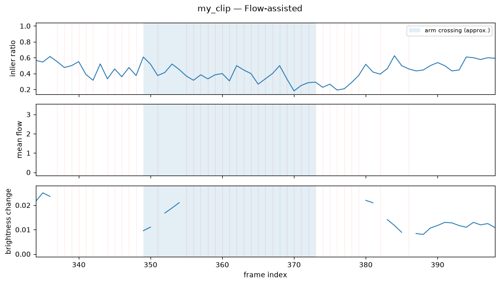
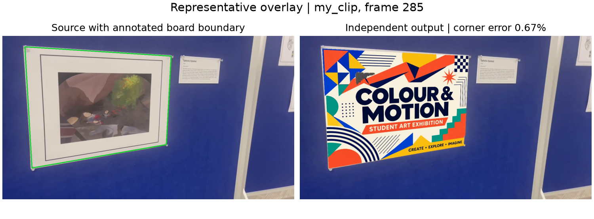
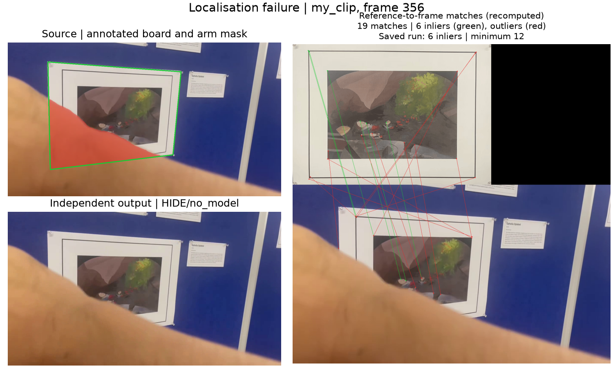

# CS4243 Lab 2 report

This compact report records how every `YOUR CODE HERE` section is exercised. Elaborate on your implementation and the results you observed; add figures, plots and grounded reasoning that show your understanding. Every reported number must name its clip (common / viewpoint / scale / blur / exit / combined / your clip), frame subset (validation / test / audit) and method variant, and must come from `overlaylab.metrics` or `overlaylab.evaluate`. Thresholds are frozen on the common clip's validation frames; each Stage's **stress table** (`python -m overlaylab.report`, `outputs/stress_tables.md`) reports the common clip (validation and test) and the Stage's two stress clips with that frozen configuration. Paste the generated table into the Stage's section unchanged and explain the row the Stage's question points at; the other rows need no interpretation.

## Authors

| Name | Student Number | NUSNET ID |
| --- | --- | --- |
| Shen Jingtao | A0287914N | E1297756 |
| Qu Qiancheng | A0312152X | E1486355 |

## Stage 1 — Localise
<!-- harris_response, detect_corners, describe_keypoints, match_descriptors; bilinear_sample, normalise_points, dlt_homography, symmetric_transfer_error, ransac_homography, transfer_points, warp_artwork; localise_board, artwork_to_frame, overlay_frame, evaluate_audit_frames; frozen success threshold -->
### Stress table (Stage 1)
<!-- generated rows: common · validation, common · test, viewpoint, scale — median / p90 corner error, success at the frozen threshold, inliers, inlier ratio, affine median error / success -->
### Question 1 — Matching
<!-- a frame pair on the viewpoint or scale clip where the matching rate collapses; rotation absorbed by the dominant orientation vs viewpoint / scale not absorbed; which descriptor component fails; the labelled SIFT cell -->
### Question 2 — Geometry
<!-- the affine column on the viewpoint clip: why the affine fit breaks as the camera orbits, related to the keystone; whole-frame warp and parallax; why parallax does not harm the overlay and one capture condition under which it would -->

## Stage 2 — Track
<!-- lk_flow, track_board (both variants on the common clip), failure_monitor; jitter and drift; frozen monitor thresholds -->
### Stress table (Stage 2)
<!-- generated rows: common · validation / test for both variants, blur, exit — corner metrics, jitter, drift, frames tracked, REINIT / HIDE counts -->
### Question 3 — Tracking
<!-- flicker (independent) vs drift (flow-assisted); eigenvalues: aperture vs brightness constancy, where each kind lies on the board (blur clip); monitor timeline of the combined clip: which statistic fired first at the card crossing and at the fast rotation, occlusion vs drift; what the exit clip's HIDE / REINIT sequence shows -->

## Stage 3 — Composite
<!-- hysteresis, compensated_difference, occlusion_mask, select_difference_thresholds, composite; frozen difference thresholds; no-occlusion baseline -->
We warped the clean reference into each frame, fitted a global gain and offset, and applied hysteresis to the compensated colour difference. We opened the mask with a disc and removed small components before compositing the artwork. Notebook 3, Section 3 selected the strong threshold of **0.25**, the weak threshold of **0.12**, and the minimum component area of **38 pixels** using the three common validation masks at 640-pixel width. The saved full-resolution minimum area is **152 pixels**, and the opening radius is **2 processing pixels**.

### Stress table (Stage 3)
<!-- generated rows: common · validation / test, combined, viewpoint — mask IoU / F1 / leakage, baseline leakage (common), false occlusion (viewpoint) -->
| row | eligible masks | scored masks | hidden masks | missing masks | overlay absent | IoU | F1 | leakage | baseline leakage | false occlusion |
|---|---|---|---|---|---|---|---|---|---|---|
| common · validation | 3 | 3 | 0 | 0 | 0 | 0.917 | 0.956 | 1.56% | 96.40% | n/a |
| common · test | 3 | 2 | 1 | 0 | 1 | 0.944 | 0.971 | 0.61% | 61.74% | n/a |
| combined (coke_unconstrained) | 6 | 4 | 2 | 0 | 2 | 0.935 | 0.966 | 0.22% | n/a | n/a |
| viewpoint (coke_perspective) | 3 | 0 | 1 | 0 | 1 | n/a | n/a | n/a | n/a | 10.65% |

IoU / F1 from the occlusion masks saved by `run_pipeline` on the ground-truth mask frames (frames on which the overlay is hidden are not scored); leakage, baseline leakage and false occlusion from `overlaylab.evaluate` on the finished videos. The viewpoint clip has empty masks: only false occlusion applies.

At full resolution, the flow-assisted run with occlusion handling reduced finished-video foreground leakage from **96.40%** to **1.56%** on common validation and from **61.74%** to **0.61%** on common test, compared with the flow-assisted no-occlusion baseline. Both runs hid the overlay on common test frame **448**, which contributed zero leakage to both means. The common test mask IoU covers the two visible frames. The combined clip achieved **0.935** mask IoU on four scored frames, with two hidden. No masks were missing.

**Boundary behavior on the common and combined crossings**

Both examples use independent single-frame localisation at **640-pixel width** with the frozen settings (Notebook 3, Sections 4 and 6).

**Common clip, test frame 144.** The difference map highlights the part of the board covered by the blue card. The no-occlusion composite paints across the card edge, while the mask-aware composite largely preserves it. Mask IoU was **0.926** and boundary F1 was **0.683**. Of **747** annotated foreground pixels missed by the predicted mask, **604** lay outside the projected board coverage, where the algorithm cannot assign an occlusion label. Another **139** lay inside coverage but had a compensated difference below the weak threshold. The missed foreground therefore came mainly from the coverage boundary, with low colour contrast accounting for most of the remaining misses.

**Combined clip, test frame 304.** The bright residual follows the card across the lower part of the tilted poster. The predicted mask captures the main occluded region, with some disagreement along the annotated contour. Mask IoU was **0.880**, mask F1 was **0.936**, and boundary F1 was **0.772**. The panel uses the estimated homography. [AI-LANGUAGE][HUMAN-CHECK]

### Question 4 — Occlusion
<!-- which occluders differencing recovers and which stay ambiguous; effect of the strong threshold and the minimum area; why hysteresis matters for thin occluders and why opening works against it (thinnest occluder that survives the frozen open_radius; what the radius buys over radius 0 on the validation masks); why the viewpoint clip produces false occlusion under strong perspective with a correct homography, and which part of the differencing is responsible -->
1. **Which occluders are recovered, and which remain ambiguous?**
The blue card is recovered where its colour contrasts with the poster. An occluder coloured like the board is ambiguous and can be missed. A shadow or specular highlight can be mistaken for foreground because it changes the board’s appearance. An occluder that stops moving remains detectable if it contrasts with the board, since each frame is compared with the clean reference.
2. **What happens when the strong threshold or minimum component area is raised?** On common validation frame 192 at 640-pixel width (Notebook 3, Section 5), raising the strong threshold from **0.25** to **0.375** or the minimum area from **38** to **228** pixels left the mask area at **15,997 pixels** and alpha leakage at **0.1%**. Enough strong seeds remained to recover the same region, and the card component exceeded both area cutoffs. Higher cutoffs can increase leakage if they remove genuine foreground.
3. **Why does hysteresis help thin occluders, and why does opening work against it?** Hysteresis retains weak pixels connected to a strong seed, which can preserve faint sections of a thin pole. Setting both thresholds to **0.25** on common validation frame 192 shrank the mask from **15,997** to **9,525 pixels** and raised alpha leakage from **0.1%** to **29.0%** (Section 5). Opening erodes the mask with a disc and then dilates what survives. If the disc cannot fit anywhere inside a thin component, erosion removes it entirely and dilation cannot restore it. With radius **2 pixels**, the thinnest horizontal strip to survive a separate synthetic check was **5 pixels** wide. In a separate comparison across the three common validation masks at 640-pixel width, changing only the radius from **0 to 2** removed a mean of **24 false-positive pixels per mask**. Mean IoU rose from **0.8976 to 0.8986**, while mean alpha leakage rose slightly from **1.35% to 1.37%**.
4. **Why does the viewpoint clip produce false occlusion even with a correct homography?** A correct homography aligns the board geometrically. Under strong foreshortening, fine texture can be sampled or blurred differently in the captured frame and the warped reference. The global gain and offset cannot account for these local changes, so the **compensated per-pixel colour difference** can exceed the foreground thresholds on an unobstructed board. In Notebook 3, Section 6, viewpoint test frame **288** has an **empty** ground-truth occlusion mask. Even with the evaluation-only ground-truth homography, the algorithm falsely masked **2.7%** of the visible board at 640-pixel width. The full-resolution flow-assisted video recorded **10.65%** false occlusion over the **two** empty-mask frames with detected overlays. This finished-video proxy is one minus visible-board coverage and also reflects feathering, resampling, and similarity between the artwork and source colours. The absent overlay on frame 288 was excluded. [AI-LANGUAGE][HUMAN-CHECK]

## Stage 4 — Your clip
### Capture and audit
<!-- capture conditions (resolution, fps, duration, board fraction, pan / distance / angle / occlusion crossing), privacy, audit annotations recorded before any method ran -->
Shen Jingtao recorded my_clip handheld on an iPhone 12 at 1280 × 720, 30 fps, for 13.7 seconds. The target was a white-bordered landscape print mounted on a blue display board. Shen estimated the print’s physical dimensions at **0.36 × 0.25 m**. Its projected area occupied 25.6–42.2% of the image across the ten audited frames.

The camera pulled back around frames 0–120, panned laterally around 0–210, and moved to an oblique view around 195–410. An arm crossed the print around frames 349–373. These ranges are approximate and use zero-based frame indices. We obtained consent and removed identifying metadata before submission.

Before running either variant, Shen annotated the four board corners on 10 frames (21, 75, 120, 165, 210, 285, 351, 356, 360, and 390). Shen annotated five occlusion masks on those frames. Frames **21 and 285** were unobstructed, while **351, 356, and 360** showed the arm crossing the print. The annotation checker confirmed that the audit was complete.

### Overlay Scorecard
<!-- outputs/scorecards/<clip_id>_scorecard.md: both temporal variants, overlaylab.evaluate --clip <clip_id> -->
In `my_clip_scorecard.md`:

**Clip**: Rectangular landscape print with a white border mounted on a blue display board. iPhone 12, 1280x720, 30 fps, 13.7 s. Estimated board dimensions 0.36 × 0.25 m. Board coverage 0.256-0.422 of image area across 10 audited frames. Handheld lateral pan with a pull-back and a change from near-frontal to oblique viewing. Pull-back approx. 0-120; lateral pan approx. 0-210; oblique view approx. 195-410; arm overlap approx. 349-373.  
**Initialisation**: Frame 0, both variants: 94 reference and 208 frame keypoints, 32 matches, 14 inliers (43.8%), median residual 0.50 px.  
**Geometry**: Success threshold 1%. Independent: tracker median 0.69%, success 40% over 10 audit frames. Finished-video median 0.68%, success 40%. Flow-assisted: tracker median 0.69%, success 30% over 10 audit frames. Finished-video median 0.69%, success 30%.  
**Temporal**: Independent: tracker jitter 5.71 px, drift n/a (0 visible audit frames at least 16 frames after localisation), first successful audit frame after the crossing: 390. Flow-assisted: tracker jitter 5.11 px, drift n/a (0 visible audit frames at least 16 frames after localisation), first successful audit frame after the crossing: 390. The board stayed in frame, so recovery after re-entry is n/a.  
**Occlusion**: Independent: mask IoU n/a, F1 n/a (0/3 occluded masks scored, 3 hidden, 0 missing). Finished-video leakage 0.00%, baseline leakage n/a, visible-board coverage 97.22% over 2 mask frames. Overlay absent on [351, 356, 360]. Flow-assisted: mask IoU n/a, F1 n/a (0/3 occluded masks scored, 3 hidden, 0 missing). Finished-video leakage 0.00%, baseline leakage n/a, visible-board coverage 95.72% over 2 mask frames. Overlay absent on [351, 356, 360].  
**Monitor**: Independent: frames 349–373: HIDE/no_model: 20, OK/none: 5. First painted frame after the crossing: 380. Flow-assisted: frames 349–373: HIDE/no_model: 20, OK/none: 5. First painted frame after the crossing: 380.  
**Description**: Both variants hid the overlay on the three arm-occluded audit frames. The evaluator consequently measured zero leakage on those frames, while no foreground masks could be scored. The coverage figures describe the two clean mask frames.  
**Uncertainty**: The corner and mask labels came from one annotator, and the crossing limits are approximate. Jitter uses motion interpolated between ten corner annotations. The first successful audit frame establishes that recovery had occurred by that frame. The thresholds were transferred from the common clip, and no personal no-occlusion baseline was run.  

In summary, flow-assisted tracking reduced tracker jitter from **5.71 px to 5.11 px**, while placement success at the frozen 1% threshold fell from **4/10 to 3/10 audit frames**. Both variants had a median corner error of **0.69%** on finite estimates. Flow assistance therefore gave slightly smoother tracking where estimates were available, but passed the placement threshold on one fewer audit frame.

The two monitor timelines above show the same response during the estimated arm crossing (frames **349–373**). Both variants flagged **20 of 25 frames** as `HIDE/no_model` and hid the overlay on all three occluded audit frames. Hiding explains the **0% measured leakage**, and mask IoU and F1 were unavailable for those frames. Both variants resumed painting at **frame 380**, and **frame 390** was the first subsequent audit frame to meet the placement threshold. [AI-LANGUAGE][HUMAN-CHECK]

**Representative overlay**

The source panel marks the annotated board boundary, and the independent output shows how the artwork follows the board’s oblique perspective. Both variants achieved a finished-video corner error of **0.67%** on this unobstructed audit frame, below the frozen **1%** success threshold.

**Failure frame**

The arm covers part of the print. The match panel shows **19 candidate matches**, of which only **6** were RANSAC inliers (green), below the frozen minimum of **12**. Both variants recorded `HIDE/no_model`, so the rendered frame leaves the original print and arm visible. This frame illustrates why measured leakage can be zero when the overlay is hidden.

### Generative comparison
<!-- the open-weight video model you chose (direct pixel generation; inference scripts permitted), its settings, the video you gave it (whole clip, a cut, or joined segments), and why (cite the model); the seed, the log, the overlaylab.evaluate --frames report, comparison table against the classical output on the same frames, [AI-GENERATION] markers -->
### Question 5 — Reflection
<!-- classical vs your generative model on your clip: geometric placement, artwork identity, occlusion order, background preservation (what the background PSNR says about generated vs composited pixels); controllability, cost; what the model generated outside the board and in front of it; whether it kept the clip's timing (compare with the staff MiniMax-H3 example in data/genai_oracle/) -->

## Evidence table
| Student file | Function | Report section | Notebook figure / table / video |
|---|---|---|---|
| keypoints.py | harris_response, detect_corners, describe_keypoints, match_descriptors | | |
| geometry.py | bilinear_sample, normalise_points, dlt_homography, symmetric_transfer_error, ransac_homography, transfer_points, warp_artwork | | |
| localisation.py | localise_board, artwork_to_frame, overlay_frame, evaluate_audit_frames | | |
| temporal.py | lk_flow, track_board, failure_monitor | | |
| compositing.py | hysteresis, compensated_difference, occlusion_mask, select_difference_thresholds, composite | | |

## AI-use disclosure table
| Tool / model | Affected artefacts (file, cell, figure, section) | Markers | What the tool contributed | How it was verified |
|---|---|---|---|---|
| | | [AI-CODE] [AI-DESIGN] [AI-VISION] [AI-GENERATION] [AI-LANGUAGE] [HUMAN-DATA] [HUMAN-CHECK] | | |
